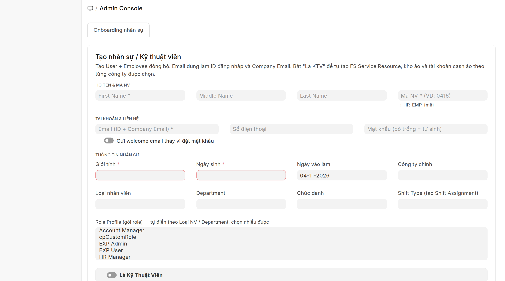
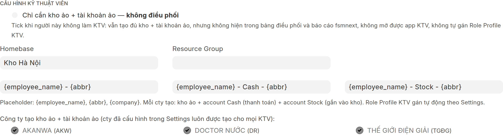
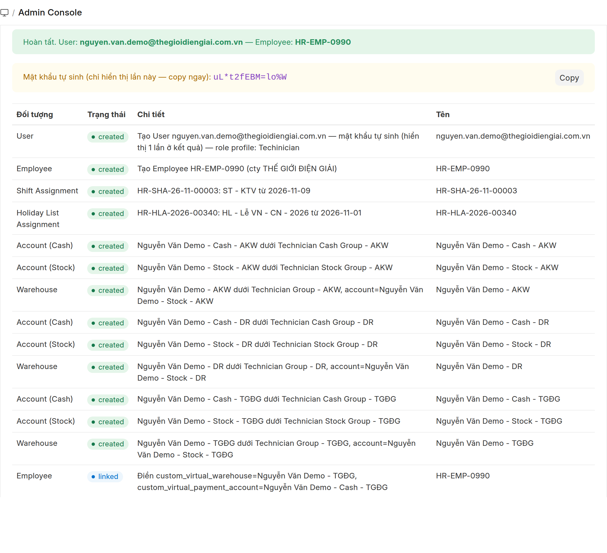
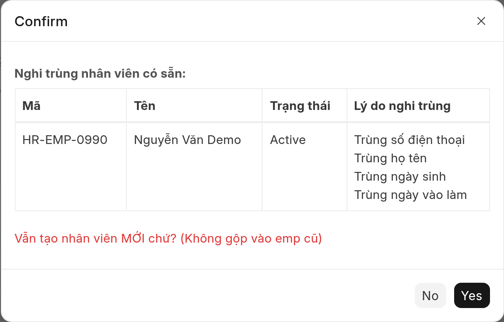
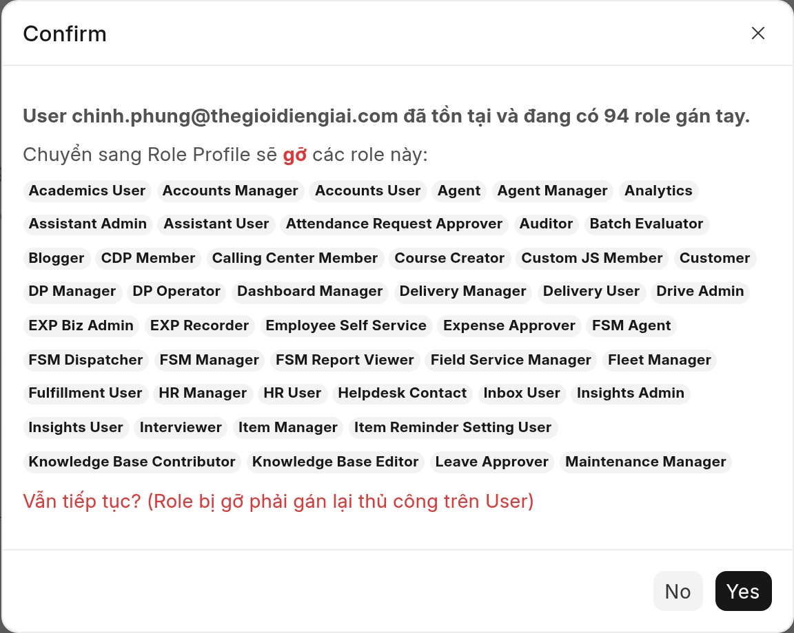

# Tạo nhân sự nhanh (Admin Console)
{: .no_toc }

**Dành cho:** System Manager / HR Manager · **Trang:** Admin Console
{: .fs-3 .text-grey-dk-000 }

> **1 form tạo trọn bộ** khi nhân viên mới vào công ty: **User** (tài khoản đăng nhập) + **Employee** (hồ sơ nhân sự) + **Shift Assignment** (gán ca) + **Holiday List Assignment** (gán lịch nghỉ) — và nếu là **Kỹ thuật viên** thì thêm luôn **FS Service Resource + kho ảo + tài khoản ảo** cho từng công ty. Thay cho việc tạo tay từng thứ ở [Tạo User](Desk-Admin-User.html) rồi [Tạo Employee](Desk-Admin-Employee.html).

---

## Mục lục
{: .no_toc .text-delta }

1. TOC
{:toc}

---

## 1. Mở trang & quyền sử dụng

- Mở: Desk → Search **"Admin Console"** · URL `/app/admin-console` → tab **Onboarding nhân sự**.
- Ai dùng được: **System Manager** và **HR Manager**.
  - HR Manager chỉ thấy tab **Onboarding nhân sự**.
  - Tab **Công cụ Admin** (chạy script, bật/tắt tính năng) chỉ dành cho System Manager.

## 2. Điền thông tin

| Trường | Bắt buộc | Ghi chú |
|---|---|---|
| **First / Middle / Last Name** | First | Tên tách 3 phần như Employee chuẩn |
| **Mã NV** | ✔ | Số cuối của mã nhân viên (VD `0416`) → hệ thống tạo **HR-EMP-0416**. Mã do HR cấp, **không tự sinh**. Trùng mã sẽ báo lỗi ngay |
| **Email** | ✔ | Dùng làm **tài khoản đăng nhập** và **Company Email** luôn |
| **Số điện thoại** | KTV: ✔ | Vào Employee + FS Service Resource |
| **Mật khẩu** | — | **Bỏ trống = hệ thống tự sinh mật khẩu mạnh** và hiện 1 lần ở Kết quả. Hoặc bật **"Gửi welcome email"** để nhân viên tự đặt qua mail |
| **Giới tính, Ngày sinh** | ✔ | Employee bắt buộc |
| **Ngày vào làm** | — | Mặc định hôm nay; cũng là ngày bắt đầu gán ca |
| **Công ty chính, Loại NV, Department, Chức danh** | — | Như Employee chuẩn |
| **Shift Type** | — | Chọn ca → tự tạo + submit **Shift Assignment** từ ngày vào làm |
| **Holiday List** | — | Chọn lịch nghỉ → tự tạo + submit **Holiday List Assignment** từ **ngày 1 của tháng vào làm** (nếu lịch bắt đầu muộn hơn thì từ ngày đầu của lịch). Ô chỉ hiện lịch còn hiệu lực tính từ ngày vào làm (lịch đã hết hạn trước ngày đó bị ẩn), nên hãy nhập Ngày vào làm trước. Lịch nghỉ quyết định ngày nào là ngày nghỉ khi tính công |
| **Role Profile** | — | Gói quyền. **Tự điền** theo Loại NV / Department (mapping khai ở Settings), sửa được, chọn nhiều được |

> ⚠️ **Role đi theo Role Profile, không gán role lẻ ở đây.** Nếu user đã tồn tại và từng được gán role lẻ bằng tay, khi thêm Role Profile các role lẻ đó sẽ bị hệ thống gỡ — form sẽ hiện **dialog xác nhận** liệt kê các role sẽ mất trước khi ghi dữ liệu (xem mục 6).

## 3. Nếu là Kỹ thuật viên

Bật **"Là Kỹ Thuật Viên"** → hiện thêm phần cấu hình:

- **Homebase** (bắt buộc) — kho/địa bàn xuất phát, VD `Kho Hà Nội`.
- **Công ty** — mọi KTV đều cần kho ảo và tài khoản ảo ở **cả 3 công ty** (Thế Giới Điện Giải, Akanwa, Doctor Nước), vì phiếu dịch vụ và thu tiền có thể phát sinh dưới bất kỳ công ty nào. Vì vậy 3 công ty đã cấu hình được **tick sẵn và khoá**, không bỏ tick được. Mỗi công ty tạo **3 món** đứng tên KTV:
  1. **Kho ảo** `Tên KTV - {viết tắt cty}` (dưới *Technician Group*)
  2. **Tài khoản Cash** `Tên KTV - Cash - {viết tắt cty}` — dùng thu tiền dịch vụ (vào FS Service Resource)
  3. **Tài khoản Stock** `Tên KTV - Stock - {viết tắt cty}` — định giá tồn kho, gắn thẳng vào kho ảo
- Đồng thời tạo **FS Service Resource** (hồ sơ điều phối KTV) link đủ user, employee, kho + tài khoản của từng công ty.
- **Công ty chính** (ở phần thông tin chung) quyết định kho ảo và tài khoản ảo nào được ghi lên hồ sơ Employee; để trống thì lấy theo công ty của Employee.
- 3 ô **template tên** để nguyên mặc định trừ khi biết rõ mình đổi gì.
- Role Profile KTV (`Techinician`) được gán **tự động**.

### Người chỉ cần kho ảo và tài khoản ảo, không làm KTV

Dùng cho nhân sự cần giữ hàng hoặc tiền đứng tên mình (kho ảo, tài khoản ảo) nhưng **không nhận việc dịch vụ**. Tick ô **"Chỉ cần kho ảo + tài khoản ảo — không điều phối"** ở đầu phần cấu hình KTV:

| | KTV thông thường | Tick "không điều phối" |
|---|---|---|
| Kho ảo + tài khoản ảo ở 3 công ty | Có | Có |
| Kho ảo không được xuất âm, tài khoản ảo không được chi quá số dư | Có | Có |
| Hiện trong bảng điều phối và ô chọn KTV của màn báo cáo `/fsm-report` | Có | **Không** |
| Mở được app KTV | Có | **Không** |
| Role Profile KTV | Tự gán | **Không tự gán** |
| Tab **FSM** trên My Workspace | Có | **Không** |

Về kỹ thuật, FS Service Resource vẫn được tạo nhưng ở trạng thái **không Active** (`Is Active` bỏ tick). Hãy chọn **Role Profile** theo công việc thực tế: nếu không chọn, tài khoản có thể không vào được Desk, khi đó kết quả sẽ hiện cảnh báo vàng.

> ⚠️ Lưu ý khi dùng lựa chọn này:
> - **Báo cáo công nợ KTV không liệt kê người này.** Hàng trong kho ảo và tiền trong tài khoản ảo của họ phải xem bằng báo cáo chuẩn (*Stock Balance*, *General Ledger*).
> - Các ô chọn `FS Service Resource` trên Desk (ví dụ bộ lọc của report *KTV Checkin Distance*, bảng phân công trong form `FS Service Appointment`) vẫn tìm được tên người này nếu gõ tìm. Không chọn họ ở các ô đó.
> - Form **không tự bật/tắt** FS Service Resource đã có sẵn; nếu trạng thái hiện tại khác với lựa chọn trên form, kết quả sẽ hiện cảnh báo vàng và bạn đổi `Is Active` trên Desk.
> - Khi User bị vô hiệu hoá rồi kích hoạt lại, hệ thống tự bật lại FS Service Resource — cần bỏ tick `Is Active` lần nữa.

> Nếu cạnh tên công ty có dấu **⚠** nghĩa là công ty đó chưa được cấu hình parent kho/account trong **Admin Console Settings** — ô này không bị khoá, tick vào thì chỉ link được kho/account có sẵn chứ không tạo mới được. Báo System Manager cấu hình trước.

## 4. Bấm Tạo & đọc kết quả

- Dòng xanh: User + Employee đã tạo xong.
- **Ô vàng "Mật khẩu tự sinh": chỉ hiển thị đúng 1 lần** — bấm **Copy** và gửi cho nhân viên ngay (khuyên nhân viên đổi mật khẩu sau khi đăng nhập lần đầu).
- Bảng bên dưới liệt kê từng đối tượng với trạng thái:
  - `created` — tạo mới · `linked` — đã có sẵn, dùng lại · `skipped` — bỏ qua vì đã đủ · `warning` — cần chú ý (đọc chi tiết).
- Có thể hiện popup **Message** kiểu *"Username already exists — Suggested Username"* hay *"Removed Employee role…"* — đây là thông báo kỹ thuật của hệ thống, **đóng và bỏ qua**, không ảnh hưởng kết quả.

## 5. Cảnh báo nghi trùng nhân viên

Trước khi tạo, hệ thống dò các Employee có sẵn **trùng SĐT / email / họ tên / ngày sinh / ngày vào làm**:

- Bấm **No** → dừng lại, mở mã nhân viên trong bảng để kiểm tra (bấm vào mã để mở hồ sơ). Nếu đúng là người cũ (VD làm lại sau nghỉ việc, hoặc HR đã import hồ sơ trước) thì **đừng tạo mới** — xử lý trên hồ sơ cũ theo [Tạo & quản lý Employee](Desk-Admin-Employee.html).
- Bấm **Yes** → xác nhận đây là người khác thật, tạo nhân viên **mới**.
- Chỉ trùng *ngày vào làm* đơn thuần (tuyển nhiều người cùng ngày) thì thường là trùng vô hại — đọc cột lý do rồi quyết.

## 6. Chạy lại có sao không?

Không sao — form theo nguyên tắc **có rồi thì dùng lại, chỉ tạo phần còn thiếu, không ghi đè**. Dùng được cho cả nhân viên đã có sẵn User + Employee (ví dụ KTV cũ chưa có đủ kho ảo ở 3 công ty):

| Đối tượng | Đã có sẵn thì |
|---|---|
| **User** | Dùng lại. Chỉ thêm Role Profile còn thiếu. Mật khẩu **không bị đổi** trừ khi bạn chủ động nhập ô Mật khẩu |
| **Employee** | Dùng lại, **không sửa thông tin nhân sự** (phòng ban, chức danh… nhập trên form bị bỏ qua); với KTV chỉ điền hai ô kho ảo và tài khoản ảo chính nếu đang trống. Nhận diện qua email đăng nhập: Employee phải đang gắn **User ID** = email nhập vào |
| **Shift Assignment** | Bỏ qua nếu đã có gán ca cùng loại |
| **Holiday List Assignment** | Đã có lịch nghỉ: cùng lịch thì bỏ qua; **khác lịch thì giữ lịch cũ** và hiện cảnh báo vàng. Muốn đổi lịch nghỉ thì tạo Holiday List Assignment mới trên Desk. Chưa có lịch nghỉ riêng: tạo mới từ **ngày 1 của tháng ghi ở ô Ngày vào làm trên form** (mặc định tháng hiện tại), để không thay đổi lịch nghỉ của các kỳ công đã chốt |
| **Kho ảo / tài khoản ảo** | Công ty nào FS Service Resource đã có dòng thì giữ nguyên kho/tài khoản cũ (kể cả đặt tên theo kiểu cũ). Công ty còn thiếu mới tạo; kho/tài khoản đã tồn tại đúng tên thì link vào, không tạo trùng. Nếu kho/tài khoản đó đang thuộc **người khác** (trùng họ tên) thì form báo lỗi và không tạo gì |
| **FS Service Resource** | **Bổ sung** dòng kho/tài khoản cho công ty còn thiếu và điền các ô đang trống (email, SĐT, homebase, Resource Group, Employee); không đụng dòng cũ, **không đổi trạng thái Active** |

Lỗi giữa chừng → **hủy toàn bộ**, không để lại dữ liệu nửa vời; sửa theo thông báo rồi bấm Tạo lại.

> ⚠️ Hai trường hợp cần kiểm tra trước khi chạy lại:
> - **Employee có sẵn nhưng chưa gắn User ID** → form coi là nhân viên mới, bắt nhập Mã NV và hiện dialog nghi trùng. Đừng xác nhận; mở Employee, gắn **User ID** rồi chạy lại.
> - **User có sẵn từng được gán role lẻ bằng tay** (tài khoản nội bộ, quản lý) → chuyển sang Role Profile sẽ gỡ các role lẻ đó. Form dò trước và hiện dialog liệt kê đủ các role sẽ mất **trước khi ghi bất cứ gì**; bấm **No** thì không có gì thay đổi. Chỉ bấm **Yes** khi đúng là muốn tài khoản đó chỉ còn role của Role Profile (role bị gỡ phải gán lại thủ công trên User).
>
> 

## 7. Lỗi thường gặp

| Thông báo | Nguyên nhân & cách xử lý |
|---|---|
| *Mã HR-EMP-xxxx đã tồn tại (của …)* | Mã NV đã cấp cho người khác — kiểm tra lại với HR, nhập mã khác |
| *Không thể tạo kho/account …: chưa cấu hình … Parent* | Công ty chưa khai parent trong Admin Console Settings — báo System Manager |
| *Account '…' đã tồn tại nhưng type là '…'* | Trùng tên với account khác bản chất — đổi template tên hoặc xử lý account cũ |
| *Kỹ thuật viên cần Homebase / số điện thoại* | Điền thiếu ở phần KTV |
| *Ngày vào làm … nằm sau lịch nghỉ '…'* | Lịch nghỉ đã chọn thuộc năm khác với ngày vào làm — chọn lịch nghỉ của đúng năm |
| *'…' đang là kho/tài khoản ảo của SR-…* hoặc *'…' đang là tài khoản kho của …* | Nhân viên mới trùng họ tên với KTV đã có — đổi 3 ô template tên ở phần cấu hình KTV (ví dụ thêm mã NV) rồi tạo lại |
| *Chỉ System Manager mới gán được Role Profile quản trị* | Role Profile đã chọn chứa quyền quản trị hoặc quyền kế toán trưởng (`Super Admin`, `Account Manager`) — System Manager thực hiện, hoặc chọn Role Profile khác |
| *Chỉ System Manager mới đổi được Role Profile, mật khẩu hay tạo Employee cho tài khoản quản trị* | Email thuộc tài khoản có quyền `System Manager`, `Script Manager`, `Stock Manager` hoặc `Accounts Manager` — chuyển cho System Manager thực hiện |
| *Chỉ System Manager mới được chạy form cho tài khoản quản trị …* | Lưu lại sẽ làm tài khoản đó mất quyền quản trị — chuyển cho System Manager thực hiện |
| Hiện dialog **nghi trùng** dù người này đã có Employee | Employee chưa gắn **User ID** nên form không nhận ra — bấm **No**, gắn User ID trên Employee rồi chạy lại |

## Liên quan

- [Tạo & quản lý Employee](Desk-Admin-Employee.html) — chi tiết hồ sơ nhân sự, người làm 2–3 công ty
- [Tạo User & phân quyền](Desk-Admin-User.html) — tạo tay từng tài khoản, quản lý role
- [Ca làm việc (Shift)](Desk-Admin-Shift.html) — quản lý Shift Type / Shift Assignment
