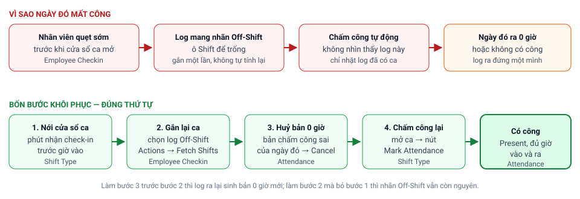
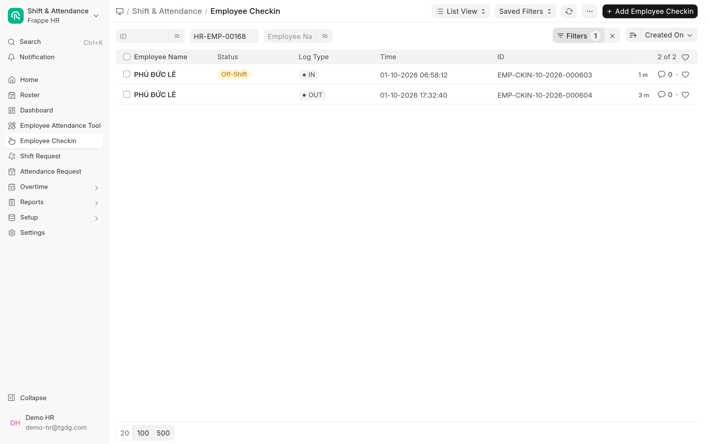
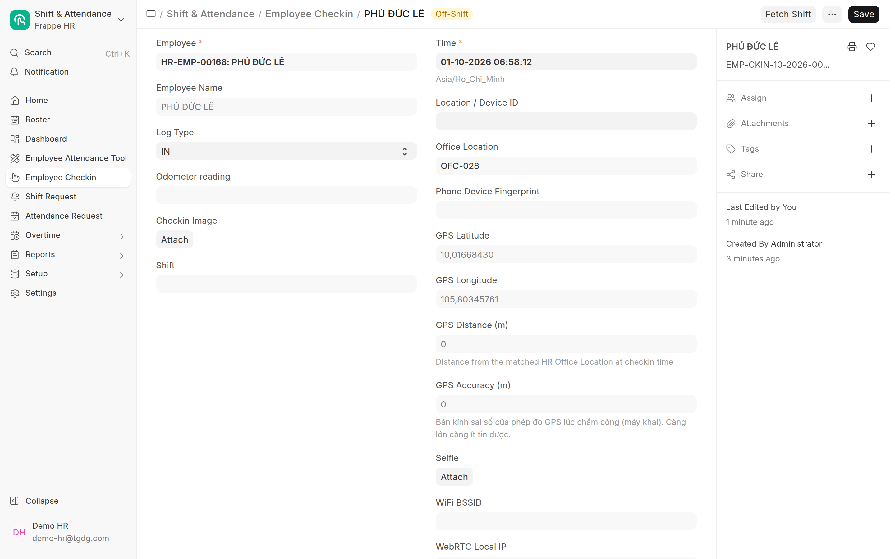
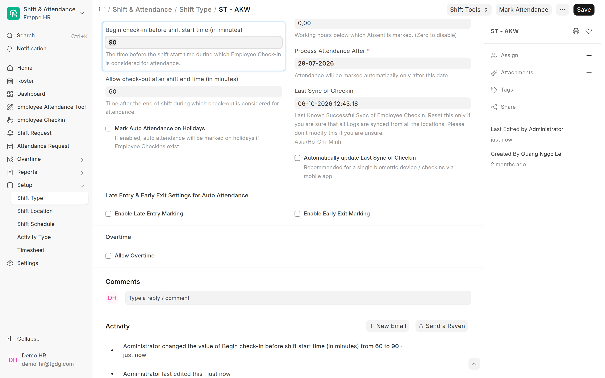
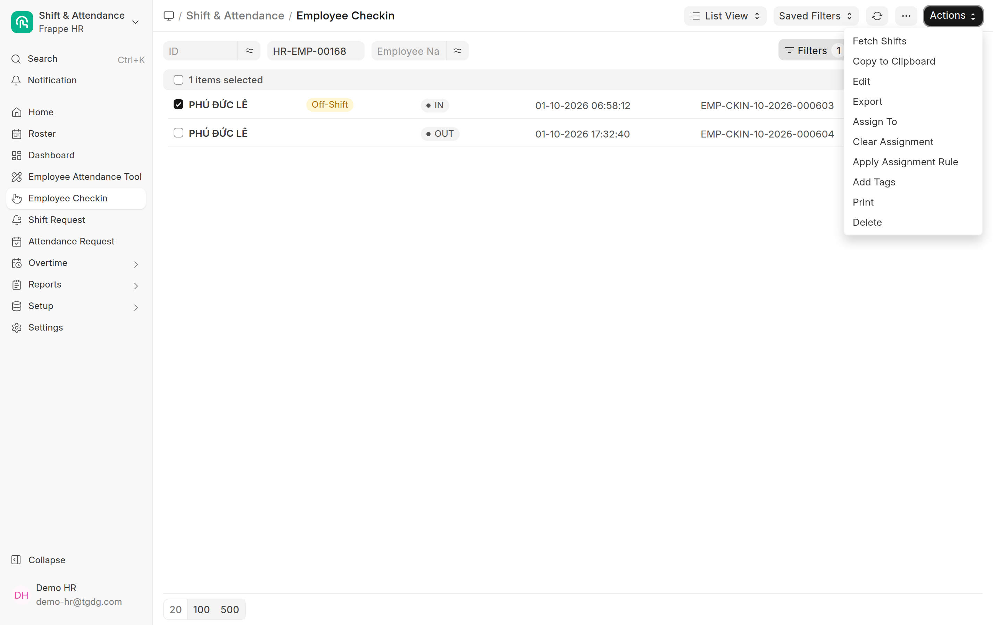
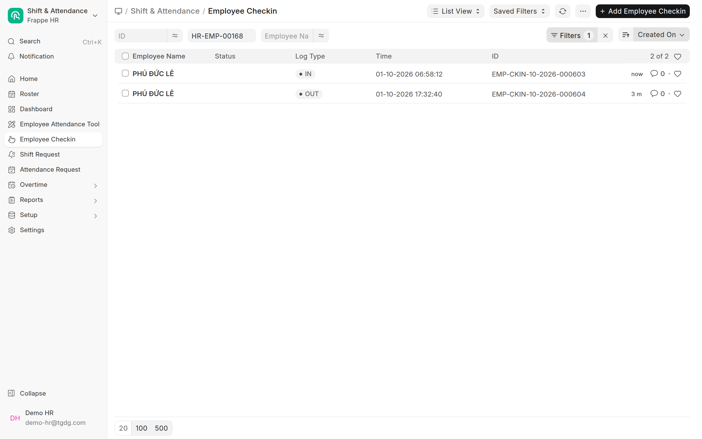
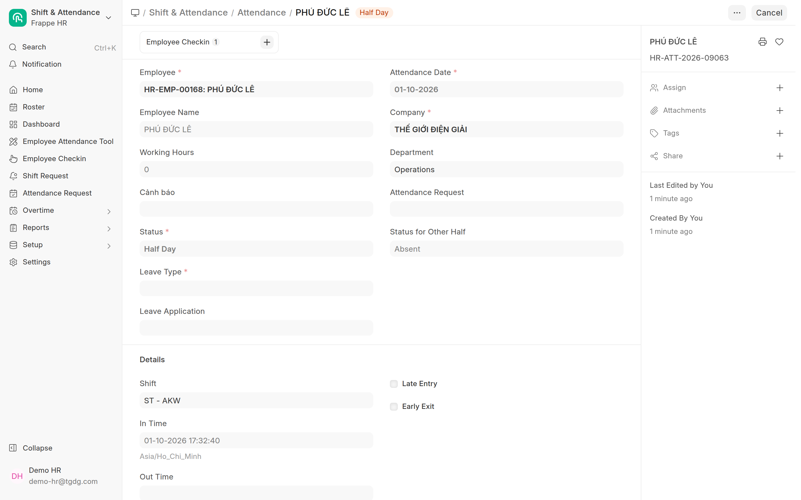
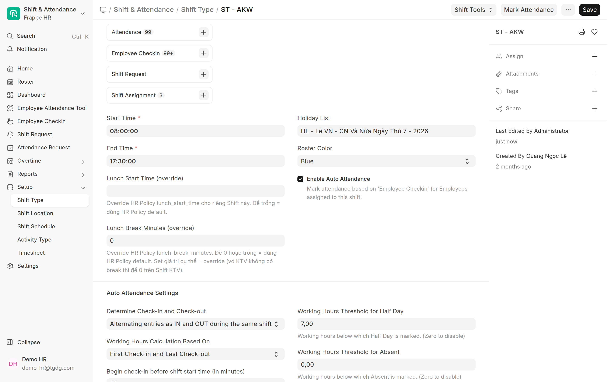
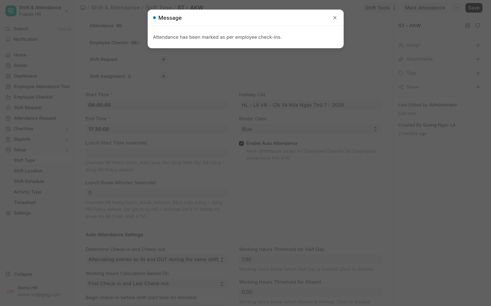
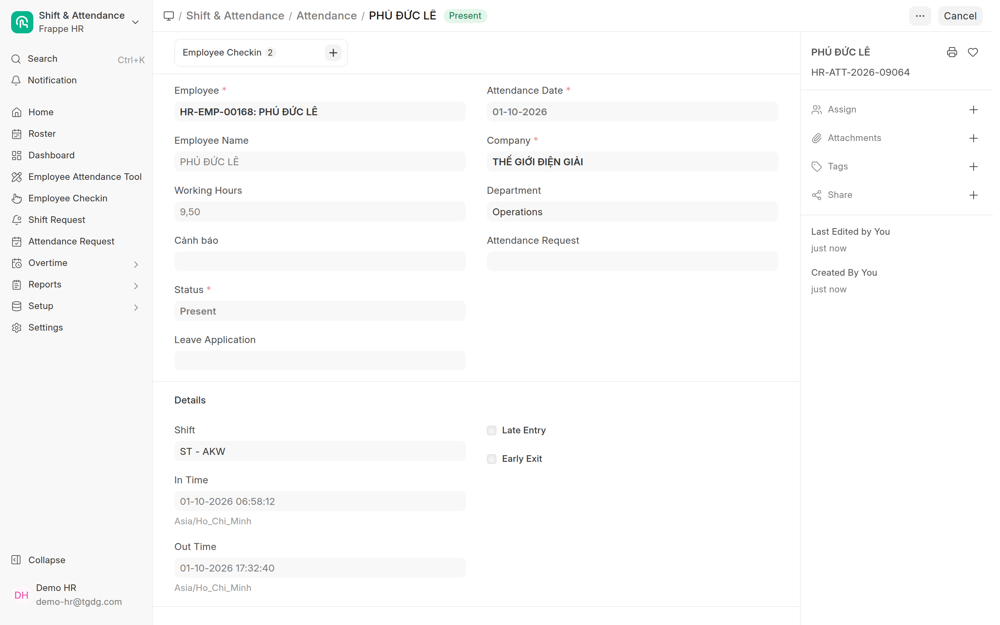

# Log chấm công Off-Shift — khôi phục công cho ngày quẹt sớm
{: .no_toc }

**Dành cho:** HR Manager · **Doctype:** Employee Checkin, Attendance, Shift Type
{: .fs-3 .text-grey-dk-000 }

> Nhân viên quẹt thẻ **trước khi ca mở cửa** (ví dụ ca mở lúc 07:00, quẹt 06:58) thì lần quẹt đó được lưu
> nhưng mang nhãn **Off-Shift** và **không bao giờ được tính công**, kể cả khi HR đã sửa lại giờ của ca.
> Bài này hướng dẫn cách khôi phục công cho ngày đó, theo đúng thứ tự để không làm hỏng thêm.

---

## Mục lục
{: .no_toc .text-delta }

1. TOC
{:toc}

---

## 1. Vì sao sửa ca xong vẫn không có công
{: #vi-sao }

  <object type="image/svg+xml" data="images/svg/cham-cong/log-off-shift.svg" style="position:absolute;inset:0;width:100%;height:100%;border:0">
    
  </object>

👆 **Bấm vào từng ô trong sơ đồ** để mở phần giải thích.
{: .fs-3 }

Mỗi lần quẹt thẻ (`Employee Checkin`) được **gắn ca đúng một lần, ngay lúc tạo**. Hệ thống xem giờ quẹt có
rơi vào cửa sổ của ca hay không. Cửa sổ này do ô **Begin check-in before shift start time** trên ca
(`Shift Type`) quyết định: ca vào 08:00 mà ô này ghi 60 phút thì cửa sổ mở từ 07:00. Quẹt lúc 06:58 là
**ngoài cửa sổ**, log được lưu với nhãn **Off-Shift** và ô **Shift** để trống.

Sau đó có ba điều xảy ra, và không điều nào tự sửa được:

- **Sửa ca không tính lại log cũ.** HR nới cửa sổ ca lên 90 phút thì chỉ các lần quẹt **từ lúc đó trở đi**
  được xét theo cửa sổ mới. Log đã mang nhãn Off-Shift vẫn giữ nguyên nhãn và ô Shift vẫn trống.
- **Chấm công tự động chỉ nhặt log đã có ca.** Lịch chấm công chạy mỗi giờ, nhưng chỉ gom những log có ô
  Shift trùng với ca đang xử lý. Log Off-Shift nằm ngoài tầm nhìn của nó **vĩnh viễn**, bất kể ngày đó đã qua
  bao lâu. "Ngày đã qua" không phải nguyên nhân.
- **Log ra đứng một mình sinh ra bản chấm công sai.** Lần quẹt ra buổi chiều vẫn nằm trong ca nên được xử lý
  bình thường, nhưng không có lần quẹt vào đi kèm. Hệ thống lấy mốc duy nhất đó làm giờ vào, giờ ra để trống,
  giờ công bằng 0 và tạo bản chấm công (`Attendance`) **Half Day 0 giờ** cho ngày đó. Bản này sau đó lại
  **chặn** mọi lần chấm công lại vì ngày đã có bản ghi.

Cách nhận ra trên Desk: mở danh sách Employee Checkin, lọc theo nhân viên và ngày. Log quẹt sớm có nhãn
vàng **Off-Shift** ở cột Status, log quẹt ra bên dưới thì không có nhãn.

Mở log đó lên sẽ thấy ô **Shift** trống, nhãn Off-Shift cạnh tên, và nút **Fetch Shift** ở góc trên.

---

## 2. Bốn bước khôi phục
{: #bon-buoc }

Thứ tự dưới đây là bắt buộc. Lý do ghi ở cuối mỗi bước.

### Bước 1. Nới cửa sổ nhận check-in của ca
{: #buoc-1 }

1. Mở ca: Desk → Search **"Shift Type"** → chọn ca của nhân viên (ví dụ `ST - AKW`).
2. Kéo xuống phần **Auto Attendance Settings**, sửa ô **Begin check-in before shift start time (in minutes)**
   cho đủ rộng để phủ giờ quẹt (ca vào 08:00, quẹt 06:58 thì cần từ 65 phút trở lên; đặt 90 cho an toàn).
3. **Save**.

> ⚠️ Chỉ sửa **ô cửa sổ** này, **không** sửa Start Time / End Time của ca. Đổi giờ vào/ra của ca đang chạy ảnh
> hưởng mọi nhân viên trong ca và toàn bộ dữ liệu quá khứ, xem [Ca làm việc & gán ca](Desk-Admin-Shift.html).
> Hệ thống cũng từ chối đổi Start Time khi ca còn log chưa chấm công.

**Vì sao phải làm trước:** bước 2 gắn lại ca bằng cách xét lại giờ quẹt so với cửa sổ **hiện tại** của ca.
Cửa sổ chưa nới thì bước 2 chạy xong vẫn ra Off-Shift y như cũ, và không có thông báo lỗi nào.

Nếu nguyên nhân không phải cửa sổ hẹp mà là nhân viên **chưa được gán ca** cho ngày đó (`Shift Assignment`),
hãy gán ca trước rồi mới sang bước 2, xem mục *Nhân viên mới* trong [Ca làm việc & gán ca](Desk-Admin-Shift.html).

### Bước 2. Gắn lại ca cho log Off-Shift
{: #buoc-2 }

1. Mở danh sách **Employee Checkin**, lọc theo nhân viên và ngày.
2. Tick chọn log có nhãn **Off-Shift** (có thể chọn nhiều log, nhiều nhân viên cùng lúc).
3. Bấm **Actions** ở góc trên phải → **Fetch Shifts**.

Thao tác này **không hiện thông báo** khi xong. Bấm nút làm mới danh sách: nhãn Off-Shift phải **biến mất**
thì mới sang bước tiếp theo. Nhãn vẫn còn nghĩa là cửa sổ ca chưa đủ rộng (quay lại bước 1) hoặc nhân viên
không có ca cho ngày đó.

Với một log đơn lẻ, mở form log đó và bấm nút **Fetch Shift** ở góc trên cũng cho kết quả tương tự.

**Vì sao phải làm trước bước 3:** lịch chấm công tự động chạy mỗi giờ. Nếu huỷ bản 0 giờ trước khi log quẹt
vào có ca, lịch sẽ lại gặp log quẹt ra đứng một mình và **sinh lại đúng bản 0 giờ** vừa huỷ.

### Bước 3. Huỷ bản chấm công 0 giờ của ngày đó
{: #buoc-3 }

1. Mở danh sách **Attendance**, lọc theo nhân viên và ngày. **Bỏ mọi lọc trạng thái** để không sót bản nháp.
2. Mở bản ghi của ngày đó. Dấu hiệu: Status **Half Day** (hoặc Absent), **Working Hours = 0**, ô **In Time**
   mang giờ của lần quẹt **ra**, ô **Out Time** trống.
3. Bấm **Cancel** → xác nhận **Yes**.

Huỷ xong, hệ thống tự **gỡ liên kết** giữa bản chấm công này và log quẹt ra, nên log đó được xét lại ở bước 4.

> ⚠️ Bản chấm công của ngày đó phải ở trạng thái **Cancelled**. Bản còn **Draft** hoặc **Submitted** đều bị coi
> là trùng. Nếu để sót, bước 4 sẽ gặp lỗi "đã có bản ghi", hệ thống **tự bật cờ bỏ qua** trên các log và ghi
> một dòng bình luận "Reason for skipping auto attendance" vào log. Khi đó phải mở từng log, bỏ tick
> **Skip Auto Attendance**, Save, rồi mới làm lại bước 4.

Nếu ngày đó **không có** bản chấm công nào (ví dụ cả hai lần quẹt đều Off-Shift) thì bỏ qua bước này.

### Bước 4. Chấm công lại ngay bằng nút Mark Attendance
{: #buoc-4 }

Không cần chờ lịch chạy. Mở lại ca (`Shift Type`) và bấm **Mark Attendance** ở góc trên.

Nút này xử lý **mọi log còn chờ của ca đó**, không riêng nhân viên vừa sửa. Việc này giống hệt những gì lịch tự
động làm mỗi giờ nên không phát sinh gì mới. Xong sẽ có thông báo:

Nếu ca có quá nhiều log chờ, thông báo đổi thành "Attendance marking has been queued" kèm liên kết theo dõi
tiến trình; chờ vài phút rồi kiểm tra.

Nút chỉ hoạt động khi ca đã tick **Enable Auto Attendance**, có **Process Attendance After** và ô
**Last Sync of Checkin** không trống. Ô cuối do lịch tự động điền mỗi giờ; nếu trống, điền giờ hiện tại
rồi Save và bấm lại.

---

## 3. Kiểm tra kết quả
{: #kiem-tra }

Mở lại danh sách Attendance của nhân viên, ngày đó phải có bản ghi mới: Status **Present**, có cả
**In Time** và **Out Time**, Working Hours là số giờ giữa hai lần quẹt. Phần **Employee Checkin** ở đầu form
phải liên kết tới **2** log.

> 💡 Giờ công hiển thị là giờ thô giữa hai lần quẹt. Giờ công dùng để xét ngưỡng Present / Half Day và lên bảng
> công đã được cắt về khung ca và trừ nghỉ trưa, xem [Bảng công tháng](Desk-HR-BangCongThang.html).

---

## 4. Vẫn không ra công — soi theo thứ tự
{: #soi-loi }

Nếu bấm Mark Attendance xong mà ngày đó vẫn không có bản Present, mở **đúng log quẹt vào** của ngày đó và
soi lần lượt:

| # | Nhìn ở đâu | Thấy gì | Nghĩa là |
|---|---|---|---|
| 1 | Thông báo sau khi bấm Mark Attendance | "An error occured… Error Log" | Mở Error Log đọc nguyên nhân |
| 2 | Ô **Shift** trên log | Trống | Nhân viên không có `Shift Assignment` phủ ngày đó, hoặc bước 2 chưa chạy |
| 3 | Ô **Shift** trên log | Ca **khác** ca vừa bấm Mark Attendance | Bấm Mark Attendance trên đúng ca ghi trong log |
| 4 | Nhãn cạnh tên | Vẫn **Off-Shift** | Cửa sổ ca chưa đủ rộng, quay lại bước 1 |
| 5 | Ô **Skip Auto Attendance** | Đang tick | Xem tab Comments của log. Có dòng "already marked" thì bước 3 làm chưa sạch. Không có dòng nào thì xem mục kế |
| 6 | Danh sách Attendance ngày đó, **bỏ lọc trạng thái** | Còn bản **Draft** hoặc **Submitted** | Huỷ bản đó rồi làm lại bước 4 |
| 7 | Lịch nghỉ của nhân viên | Ngày đó là **ngày lễ** | Chấm công tự động bỏ qua ngày lễ, không báo gì. Tính công bằng đơn làm thêm hoặc chấm công bù |
| 8 | Ô **Process Attendance After** trên ca | Muộn hơn ngày quẹt | Ngày trước mốc này không được chấm tự động, chấm tay |

Cờ **Skip Auto Attendance** còn có thể do **luật tính công** của công ty bật, không kèm bình luận nào: ngày đó
đã có bản chấm công khác (do đơn nghỉ, HR chấm tay); ngày đó là ngày nghỉ của nhân viên mà không có đơn làm
thêm hay chấm công bù được duyệt; hoặc mọi lần quẹt hôm đó đều là quẹt ngoài văn phòng theo đơn mà đơn chưa
được duyệt. Những trường hợp này không phải lỗi, xem [Soát chấm công ngoài văn phòng](Desk-HR-SoatChamCongNgoai.html).

---

## Hỏi đáp
{: #hoi-dap }

**Mark Attendance chạy mất bao lâu?**
Vài giây, có thông báo ngay. Chỉ khi ca có rất nhiều log chờ, hệ thống mới đưa vào hàng đợi và báo "queued".

**Không bấm Mark Attendance, chờ lịch tự động có được không?**
Được. Sau bước 2 và 3, lịch chấm công mỗi giờ sẽ tự tạo bản Present ở lần chạy kế tiếp. Nút Mark Attendance
chỉ để khỏi chờ.

**Có nên nới cửa sổ ca thật rộng cho khỏi phải xử lý?**
Cửa sổ rộng làm hai ca kề nhau (sáng, chiều) dễ **chồng lấn**: một lần quẹt rơi vào cửa sổ của cả hai ca thì có
thể bị gắn vào ca sai. Với ca cả ngày, 60 đến 120 phút là đủ. Ca sáng và ca chiều của cùng một nhân viên thì
giữ cửa sổ hẹp.

**Nhân viên quẹt sớm thì ngày đó có bị tính Half Day không?**
Không. Giờ vào sớm hơn giờ ca được cắt về giờ vào ca khi tính giờ công, nên quẹt sớm không thêm cũng không
bớt công. Vấn đề chỉ là log có được gắn ca hay không.

**Một lần quẹt ra rơi ngoài cửa sổ "sau giờ tan ca" cũng xử lý như vậy?**
Đúng. Ô tương ứng là **Allow check-out after shift end time (in minutes)** trên ca. Nới ô đó rồi làm tiếp bước
2 đến 4 y hệt.

**Fetch Shifts có làm hỏng log đã có công không?**
Log đã liên kết với một bản chấm công thì không bị gắn sang ca khác. Tuy vậy chỉ nên tick đúng các log mang nhãn
**Off-Shift**, không chọn cả trang: log cũ nằm ngoài cửa sổ hiện tại của ca có thể bị gỡ ca khi xét lại.

---

## Liên quan
- [Theo dõi & sửa chấm công](Desk-HR-ChamCong.html) · [Ca làm việc & gán ca](Desk-Admin-Shift.html) ·
  [Soát chấm công ngoài văn phòng](Desk-HR-SoatChamCongNgoai.html) · [Bảng công tháng](Desk-HR-BangCongThang.html)
- Kỹ thuật: [Tổng quan & vận hành chấm công](Cham-Cong-Tong-Quan.html) · [Holiday & Shift Setup](HR-Holiday-Shift-Setup.html)
