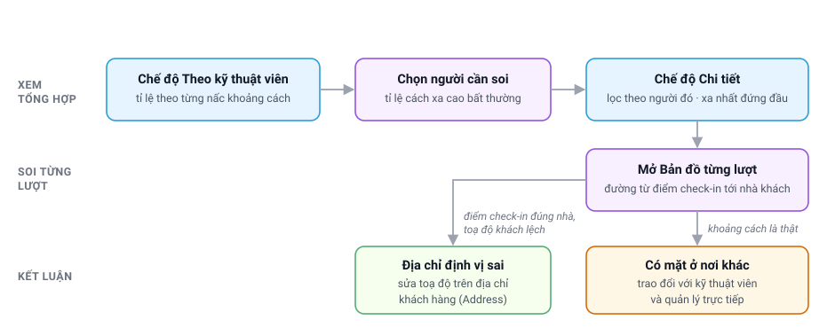

# Báo cáo khoảng cách check-in — FSMNext

> Đối tượng: **quản lý dịch vụ** có role **System Manager** (báo cáo chỉ mở được với role này).
>
> Báo cáo cho biết kỹ thuật viên check-in **cách nhà khách hàng bao xa** ở các lịch hẹn đã hoàn
> thành, và giúp phân biệt hai nguyên nhân của một lượt check-in xa: **địa chỉ khách hàng được định
> vị sai**, hay **kỹ thuật viên có mặt ở nơi khác**.

| Nhận vào | Bàn giao ra |
|---|---|
| Lượt check-in của kỹ thuật viên trên lịch hẹn dịch vụ (`FS Service Appointment`) đã *Completed*, kèm vị trí check-in | Danh sách kỹ thuật viên và lượt cần xem lại; địa chỉ khách hàng (`Address`) cần sửa |

---

## Mục lục

1. [Mở báo cáo và bộ lọc](#mo-bao-cao)
2. [Chế độ Theo KTV](#theo-ktv)
3. [Chế độ Chi tiết](#chi-tiet)
4. [Phân biệt địa chỉ sai với có mặt ở nơi khác](#phan-biet)
5. [Câu hỏi thường gặp](#hoi-dap)

---

## 1. Mở báo cáo và bộ lọc
{: #mo-bao-cao }

Trên Desk, gõ **KTV Checkin Distance** vào ô tìm kiếm và chọn mục *Report*.

| Bộ lọc | Ý nghĩa |
|---|---|
| **Từ ngày / Đến ngày (check-in)** | Theo ngày kỹ thuật viên check-in. Mặc định là một tháng gần nhất |
| **Chế độ xem** | *Theo KTV* — mỗi dòng một kỹ thuật viên; *Chi tiết* — mỗi dòng một lượt check-in |
| **KTV** | Chỉ xem một kỹ thuật viên (`FS Service Resource`) |
| **Chỉ hiện lượt cách khách từ (km)** | Chỉ có ở chế độ *Chi tiết*; mặc định 2 km |

Báo cáo chỉ tính lịch hẹn **đã Completed** và kỹ thuật viên **chưa bị huỷ khỏi lịch**.

---

## 2. Chế độ Theo KTV
{: #theo-ktv }

Mỗi dòng là một kỹ thuật viên, người có khoảng cách trung vị lớn nhất đứng đầu.

| Cột | Ý nghĩa |
|---|---|
| **Lượt check-in** | Số lượt check-in trong khoảng ngày đã chọn |
| **Lượt đo được** | Lượt có đủ toạ độ của cả kỹ thuật viên lẫn khách hàng. Các cột tỉ lệ bên phải tính trên số lượt này |
| **Tại nhà khách (%)** | Check-in cách địa chỉ khách không quá ngưỡng *same_location_threshold* trong **FSM Settings** (mặc định 100 m) — cùng quy tắc với ô *có mặt tại nhà khách* trên lịch hẹn |
| **100-500 m · 0,5-2 km · > 2 km (%)** | Các nấc xa dần. Mốc đầu của nấc thứ nhất lấy theo ngưỡng ở trên, nên tên cột đổi theo ngưỡng (mặc định *100-500 m*). Cột **> 2 km** được tô đỏ khi từ 40% trở lên |
| **Trung vị (m)** | Một nửa số lượt gần hơn con số này, một nửa xa hơn |
| **Ở dưới 1 phút (%)** | Lượt check-in rồi check-out trong chưa tới một phút |
| **KTV không gửi toạ độ** | Lượt check-in không kèm vị trí, nên không đo được |
| **Khách không có toạ độ** | Địa chỉ khách hàng chưa được định vị, nên không đo được |

> ℹ️ Một tỉ lệ cao chưa phải kết luận. Kỹ thuật viên phụ trách vùng xa hoặc nhiều địa chỉ mới thường
> gặp địa chỉ định vị sai hơn. Luôn xem tiếp [chế độ Chi tiết](#chi-tiet) trước khi kết luận.

---

## 3. Chế độ Chi tiết
{: #chi-tiet }

Mỗi dòng là một lượt check-in cách khách **từ ngưỡng lọc trở lên**, lượt xa nhất đứng đầu. Lọc thêm
theo **KTV** để xem riêng một người.

| Cột | Ý nghĩa |
|---|---|
| **Giờ check-in**, **KTV** | Ai check-in, lúc nào |
| **SA**, **WO** | Lịch hẹn và phiếu công việc (`FS Work Order`); bấm để mở phiếu |
| **Cách khách (km)** | Đường chim bay từ điểm check-in tới toạ độ khách hàng |
| **Ở lại (phút)** | Thời gian từ check-in tới check-out |
| **Toạ độ khách lấy từ** | *Nhập thủ công trên lịch hẹn*, hoặc *Định vị từ địa chỉ* (hệ thống tự định vị từ địa chỉ khách hàng) |
| **Tỉnh**, **Địa chỉ khách** | Địa chỉ trên lịch hẹn |
| **Bản đồ** | Mở Google Maps chỉ đường từ điểm check-in tới toạ độ khách hàng |

---

## 4. Phân biệt địa chỉ sai với có mặt ở nơi khác
{: #phan-biet }

Mở **Bản đồ** của lượt cần xem, rồi đối chiếu:

| Hiện tượng | Thường là | Xử lý |
|---|---|---|
| Điểm khách trên bản đồ nằm ở tỉnh khác với cột **Tỉnh**, hoặc rơi vào trung tâm tỉnh/thành phố | Địa chỉ khách hàng **định vị sai** | Sửa địa chỉ — xem bên dưới |
| Điểm check-in nằm đúng con đường hoặc khu dân cư trong cột **Địa chỉ khách**, nhưng điểm khách nằm ở vị trí khác | Địa chỉ khách hàng **định vị sai** | Sửa địa chỉ — xem bên dưới |
| Nhiều lượt của **nhiều kỹ thuật viên** ở cùng một khách đều xa như nhau | Địa chỉ khách hàng **định vị sai** | Sửa địa chỉ — xem bên dưới |
| Điểm khách đúng địa chỉ, điểm check-in ở nơi khác (văn phòng, nhà riêng, một khách hàng khác) | Kỹ thuật viên **check-in ở nơi khác** | Trao đổi với kỹ thuật viên và quản lý trực tiếp |
| Check-in ở nơi khác và **Ở lại** dưới một phút | Check-in và check-out liền nhau, không tại nhà khách | Trao đổi với kỹ thuật viên và quản lý trực tiếp |

**Sửa địa chỉ định vị sai** — chọn một trong hai cách:

| Cách | Thao tác | Tác dụng |
|---|---|---|
| Sửa địa chỉ khách hàng | Mở địa chỉ (`Address`) của khách, sửa các dòng địa chỉ, phường/xã, tỉnh cho **đầy đủ và đúng** rồi lưu | Hệ thống bỏ toạ độ cũ và **tự định vị lại** ở lần dùng sau; áp dụng cho mọi lịch hẹn dùng địa chỉ này, kể cả khi xem lại báo cáo |
| Nhập toạ độ trên một lịch hẹn | Trên lịch hẹn, tick **Nhập toạ độ thủ công**, nhập **Latitude** và **Longitude** đúng của nhà khách | Chỉ áp dụng cho lịch hẹn đó |

---

## 5. Câu hỏi thường gặp
{: #hoi-dap }

**Vì sao một lượt check-in không có trong báo cáo?**
Báo cáo chỉ tính lịch hẹn đã *Completed* và kỹ thuật viên chưa bị huỷ khỏi lịch. Lượt thiếu toạ độ
vẫn được đếm ở cột **Lượt check-in**, nhưng không có khoảng cách nên không vào các cột tỉ lệ và không
hiện ở chế độ *Chi tiết*.

**Ngưỡng "tại nhà khách" lấy ở đâu?**
Từ tham số cấu hình *same_location_threshold* trong **FSM Settings**. Đổi tham số này thì cột
**Tại nhà khách** và ô *có mặt tại nhà khách* trên lịch hẹn cùng đổi theo.

**Đã sửa địa chỉ khách hàng, vì sao báo cáo chưa đổi ngay?**
Toạ độ mới chỉ được định vị khi hệ thống cần dùng địa chỉ đó lần sau, ví dụ khi tính quãng đường cho
một lịch hẹn. Cần kết quả đúng ngay cho một lịch hẹn thì dùng cách **Nhập toạ độ thủ công**.

**Ai xem được báo cáo này?**
Chỉ tài khoản có role **System Manager**.

---

## Liên quan

- **[Quy trình dịch vụ hiện trường (FSMNext)](FSMNext-Quy-Trinh-Dich-Vu.html)** — vòng đời lịch hẹn, check-in và check-out, tiền công khi một phiếu có nhiều lịch hẹn
- **[B · Điều phối và hiện trường](Quy-Trinh-B-Hien-Truong.html#hien-truong)** — các bước kỹ thuật viên làm tại nhà khách hàng
